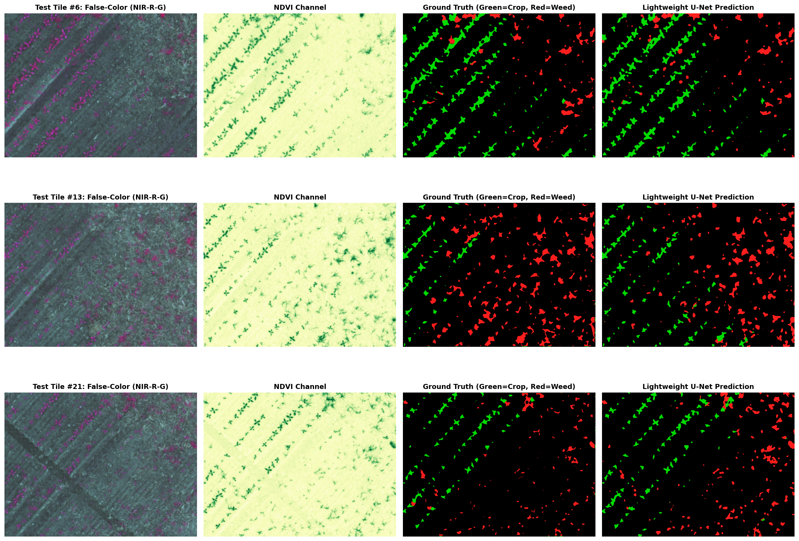
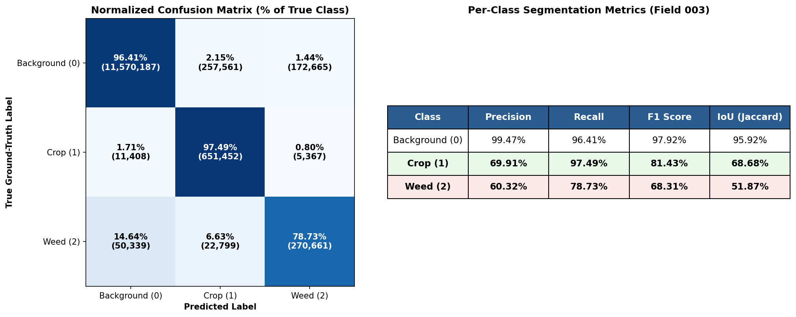

# 🌿 Edge Deployment of Lightweight Multispectral U-Net for Semantic Weed Mapping
**B.Tech Major Project**

## 📂 Dataset Access
- **Original Source:** [ETH Zurich WeedMap (RedEdge-M Multispectral)](https://www.research-collection.ethz.ch/entities/researchdata/0a5dcd76-cc44-4fbe-9f48-d8a717c90a30)
- **Cleaned & Ready-to-Use Dataset:** [Download my corrected version on Kaggle](https://www.kaggle.com/datasets/rishibihari/weedmap-rededge) 
  *(Note: This custom Kaggle version pre-applies the 16-bit label remapping and mask polarity fixes discussed below, making it instantly ready for PyTorch Dataloaders).*
  
**Live Interactive Demo:** [Click here to try the web app on Hugging Face](https://huggingface.co/spaces/rishikr45/Precision-Agri-Segmentation)

*👆 **Live Web Interface:** The deployed application provides a simple drag-and-drop interface where users can upload multispectral field images and instantly receive a segmented output map, demonstrating the model's fast inference capabilities in real-time.*

## 📌 Project Overview
In precision agriculture (smart farming), automated weed removal using drones or robotic vehicles requires highly accurate pixel-level separation of crops and weeds. While standard camera indices like NDVI easily separate green plants from bare soil, they fail to distinguish a crop from a weed because both are green. 

This major project implements a **1.94M-parameter Lightweight U-Net** using PyTorch to perform 3-class semantic segmentation (Background, Crop, Weed). It solves the colour confusion by looking at the internal biological health of the plants using the **ETH Zurich WeedMap RedEdge-M Multispectral Dataset**.

### 🛠️ Key Contributions & Dataset Engineering
Training a model on the raw ETH Zurich dataset out-of-the-box yields a very poor Weed F1 score of ~19.88%. During this project, we identified and resolved two critical, undocumented encoding bugs in the raw dataset archive:
1. **16-bit Ground-Truth Discrepancy:** The actual mask images encoded the "Crop" class as `10000` instead of the documented `1`.
2. **Inverted Mask Polarity:** The binary validity masks were inverted (`0` for valid field, `255` for invalid borders), which mistakenly wiped out 99.99% of valid crop pixels during standard training loss calculations.

By engineering a custom PyTorch `Dataset` loader to remap the labels and correctly invert the ignore masks, the model's performance was drastically improved. The cross-entropy training loss steadily decreased over a 25-epoch training period.

*👆 **Training Performance:** As seen in the graph above, the training loss smoothly drops from over 0.65 down to below 0.20. This steady downward curve shows that the model successfully learned to distinguish the plant classes without fluctuating or struggling with the corrected dataset.*

## 👁️ Visual Predictions
The AI model processes the images to accurately map the fields. Below is a side-by-side comparison showing how our model sees and decides.

*👆 **Understanding the Visuals (Left to Right):**
1. **False-Color Input (NIR-R-G):** The raw multispectral image capturing Near-Infrared and Red bands to highlight plant biology.
2. **NDVI Channel:** A standard vegetation index that easily highlights all living plants in bright green, but cannot separate crops from weeds.
3. **Ground Truth:** The actual human-labelled correct map (Green = Crop, Red = Weed).
4. **Lightweight U-Net Prediction:** Our model's final output. Notice how closely it matches the Ground Truth, successfully ignoring the background soil and neatly separating the red weeds from the green crops.*

## 📊 Quantitative Results (Test Field 003)
The model was evaluated on over 13 million unseen valid pixels from Test Field `003`. 

- **Crop F1 Score:** 81.43% (97.49% Recall)
- **Weed F1 Score:** 68.31% (78.73% Recall)
- **Weed ROC-AUC:** 0.9827

### 🚫 Agronomic Risk Metrics
In real-world farming, accidentally spraying herbicide chemical on the main crops causes heavy financial loss. The model is specifically optimized with inverse-frequency class weighting to minimize this risk.

*👆 **Confusion Matrix Analysis:** The dark blue diagonal blocks show our correct predictions. The most important metric for farmers is the tiny **0.80%** box in the middle-right. This proves the model almost never mistakes a valuable crop for a weed (Herbicide Damage Risk), ensuring the drone won't accidentally spray the wrong plants. The Weed Escape Risk (weeds mistaken for crops) is kept at an acceptable 6.63%.*

## 🔬 Spectral Ablation Study
A controlled testing process (ablation study) was conducted to prove the necessity of multispectral cameras over standard RGB cameras. The 6-channel full multispectral stack (`B, G, R, RedEdge, NIR, NDVI`) significantly outperformed the basic camera setups:

| Configuration | Channels | Crop F1 | Weed F1 | Crop Damage Risk |
| :--- | :---: | :---: | :---: | :---: |
| Standard RGB | 3 | 53.86% | 55.64% | 0.82% |
| NDVI Index | 1 | 61.83% | 60.37% | 2.96% |
| **Full Multispectral** | **6** | **81.43%** | **68.31%** | **0.80%** |

## 💻 Current Edge Deployment Status (Software)
To make sure this AI model can run directly on a drone without needing internet or cloud servers, the following software deployment steps are fully completed:
1. **Model Compression:** The trained PyTorch weights (`.pth`) were successfully exported into a lightweight, hardware-agnostic `.onnx` file with a size of ~7.6 MB. 
2. **ARM64 Emulation:** The entire AI pipeline was packed using Docker and successfully run on an ARM64 hardware emulator. 

*👆 **Edge Device Emulation:** The terminal output above confirms that the 7.6 MB ONNX model successfully initialized and ran inference inside an emulated ARM64 edge environment without crashing. It achieved a median latency of ~61,754 ms per tile, proving the software is structurally 100% ready to be loaded onto physical drone companion computers.*

## 🚀 Future Scope & Hardware Acceleration
The next logical step is moving from software simulation to physical hardware for real-world drone flights:
1. **Physical Drone Integration:** Load the ONNX model onto a physical Companion Computer (like a Raspberry Pi 4 or NVIDIA Jetson Nano) and connect it to a **Cube Orange+** flight controller running **ArduPilot** to trigger real-time precision spraying commands.
2. **Custom Chip Design (FPGA):** The ultimate future goal is to write the complete AI architecture in Verilog code and program it onto an **FPGA board** (like AMD Xilinx Zynq). This will convert the software AI into a dedicated physical digital circuit, ensuring instant processing speed and saving maximum drone battery life.

## 👥 Project Team
| Team Member | Roll Number |
| :--- | :--- |
| **Rishi Kumar** | 230104012 |
| **Harshit** | 230104025 |

## 📁 Repository Structure
- `/CODE` - Contains the full training Jupyter Notebook and Gradio web-app script.
- `/MODELS` - Contains the saved PyTorch `.pth` weights and optimized `.onnx` edge models.
- `/RESULTS` - Contains high-resolution prediction plots, confusion matrices, and ablation study charts.
